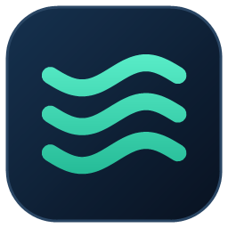
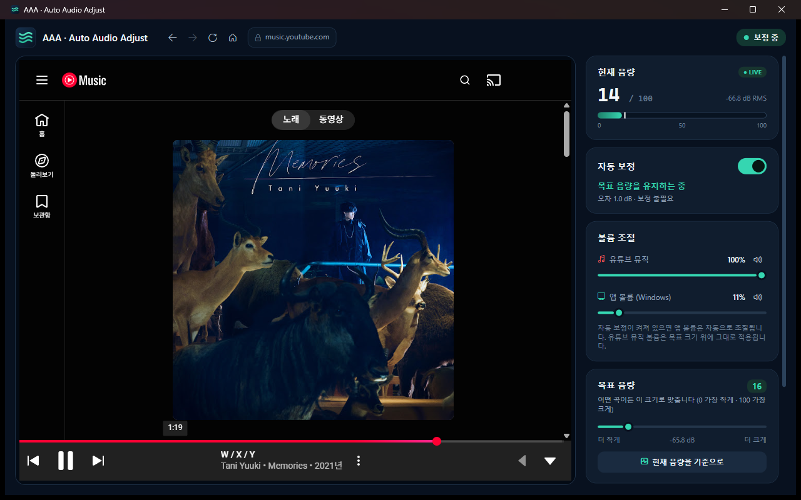
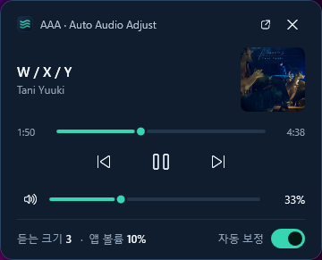
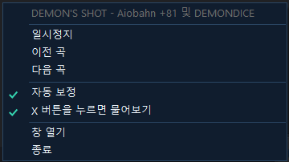
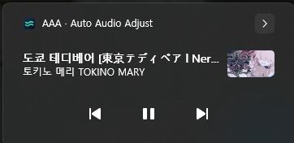

<p align="center">
  
</p>

<h1 align="center">AAA · Auto Audio Adjust</h1>

<p align="center">
  유튜브 뮤직을 앱 안에서 재생하면서, 곡이 바뀌어도 <b>같은 크기로 들리도록</b> 볼륨을 자동으로 맞춰 주는 Windows 앱입니다.
</p>



## 주요 기능

- **유튜브 뮤직 내장**: 앱 창 안에서 유튜브 뮤직을 그대로 씁니다. 로그인, 재생목록, 추천, 가사, 프리미엄이 모두 그대로입니다. 로그인은 앱을 다시 켜도 유지됩니다.
- **듣는 크기 0~100**: 숫자 하나로 원하는 크기를 정하면, 어떤 곡이든 그 크기로 들리도록 맞춥니다.
- **자동 음량 보정**: 실제로 재생되는 소리를 RMS로 측정해서 목표 크기에 맞게 앱 볼륨을 조절합니다.
  - 갑자기 커진 곡은 빠르게 낮추고, 작은 곡은 천천히 올립니다.
  - 무음 구간에서는 볼륨을 건드리지 않습니다.
- **이 앱의 소리만** 측정하고 조절합니다. 크롬, 디스코드, 게임처럼 다른 프로그램의 소리와 볼륨은 그대로입니다.
- **볼륨 조절 패널**: 유튜브 뮤직 볼륨과 앱 볼륨(Windows)을 따로 조절하고 음소거할 수 있습니다.
- **트레이 실행**: 창을 닫아도 트레이에서 음악과 자동 보정이 계속됩니다.
- **미니 플레이어**: 창을 열지 않고 트레이에서 곡 정보, 재생 위치 이동, 유튜브 뮤직 볼륨, 자동 보정을 조작합니다.
- **Windows 미디어 컨트롤**을 지원합니다. 키보드의 미디어 키로도 조작할 수 있습니다.

## 화면 구성

### 오른쪽 제어 패널

| 카드 | 설명 |
|---|---|
| **현재 음량** | 지금 들리는 크기를 0~100으로 보여 줍니다(작은 글씨는 dB). 흰 선은 목표 크기입니다. |
| **자동 보정** | 켜기/끄기와 현재 상태(높이는 중, 낮추는 중, 유지 중)를 보여 줍니다. |
| **볼륨 조절** | 유튜브 뮤직 볼륨과 앱 볼륨(Windows)입니다. 자동 보정이 켜져 있으면 앱 볼륨은 자동으로 움직입니다. |
| **목표 음량** | 맞추고 싶은 크기를 0(가장 작게)~100(가장 크게)으로 정합니다. **현재 음량을 기준으로**를 누르면 지금 듣는 곡의 크기를 목표로 정합니다. |
| **안전 범위** | 자동 보정이 움직일 수 있는 앱 볼륨의 최소·최대값입니다. |

> 유튜브 뮤직 볼륨은 목표 크기 위에 그대로 적용됩니다. 예를 들어 유튜브 뮤직을 50%로 낮추면 자동 보정이 그만큼 앱 볼륨을 올려 되돌리지 않고, 실제로 절반 크기로 들립니다. 현재 음량 막대의 흰 선도 그 위치로 함께 움직입니다.

### 트레이와 미니 플레이어

창의 X 버튼을 누르면 **트레이로 보낼지, 종료할지** 물어봅니다. "다음부터 묻지 않기"를 고르면 그 선택을 기억하고, 트레이 메뉴에서 다시 켤 수 있습니다.

| 미니 플레이어 (트레이 아이콘 왼쪽 클릭) | 트레이 메뉴 (오른쪽 클릭) |
|---|---|
|  |  |

**미니 플레이어**
- 지금 재생 중인 곡의 제목, 아티스트, 앨범 이미지를 보여 줍니다.
- **재생 시간**: 현재 위치와 곡 길이를 보여 줍니다. 바를 클릭하거나 끌면 그 위치로 이동합니다.
- **이전 / 재생·일시정지 / 다음** 버튼이 있습니다.
- **유튜브 뮤직 볼륨**: 슬라이더와 음소거 버튼으로 조절합니다. 메인 창의 유튜브 뮤직 볼륨과 같은 값입니다.
- 아래쪽에 듣는 크기와 앱 볼륨이 보이고, **자동 보정**을 바로 켜고 끌 수 있습니다.
- 다른 곳을 클릭해도 닫히지 않습니다. 오른쪽 위 **X 버튼**, Esc 키, 트레이 아이콘을 다시 클릭하면 닫힙니다.
- 빈 곳을 잡고 끌어서 원하는 위치로 옮길 수 있습니다. 옮긴 위치는 앱이 켜져 있는 동안 유지됩니다.

- 트레이 아이콘을 **더블클릭**하면 창이 다시 열립니다.
- 아이콘에 마우스를 올리면 지금 재생 중인 곡이 보입니다.

### Windows 미디어 컨트롤

볼륨 키를 누르거나 빠른 설정을 열면 Windows 미디어 컨트롤에 앱 이름과 곡 정보가 나옵니다. 여기서도 이전/재생/다음을 누를 수 있습니다.



## 설치와 실행

1. [Releases](https://github.com/tjdgns0618/AutoAudioAdjust/releases)에서 `AutoAudioAdjust.App.exe`를 내려받아 실행합니다.
2. 앱 안의 유튜브 뮤직에서 로그인하고 곡을 재생합니다.
3. **자동 보정**이 켜져 있으면 바로 보정이 시작됩니다. 처음에는 좋아하는 곡에서 **현재 음량을 기준으로**를 눌러 목표를 정하면 편합니다.

**필요 환경**
- Windows 11 또는 Windows 10 (빌드 20348 이상)이 필요합니다. 앱별 소리 측정 기능을 쓰기 때문입니다.
- Microsoft Edge WebView2 런타임이 필요합니다. Windows 11에는 기본으로 설치되어 있습니다.
- 포터블 실행 파일이라 .NET 런타임을 따로 설치할 필요가 없습니다.

**앱이 만드는 것**
- 설정과 로그인 정보는 `%LOCALAPPDATA%\AutoAudioAdjust`에 저장합니다.
- 시작 메뉴에 `AAA · Auto Audio Adjust` 바로가기를 만듭니다. Windows 미디어 컨트롤에 앱 이름과 아이콘을 표시하는 데 필요합니다.

## 동작 방식

- **측정**: Windows의 앱별 오디오 캡처(process loopback)로 앱 안 유튜브 뮤직이 실제로 내는 소리를 받아 0.1초마다 진짜 RMS를 계산합니다. 앱 볼륨이 적용된 뒤의 소리를 측정하므로 **귀에 들리는 크기**와 같습니다.
- **듣는 크기**: 0~100은 -75 dB ~ -18 dB(RMS)에 대응합니다. 설정에는 dB 값으로 저장됩니다.
- **유튜브 뮤직 볼륨**: 측정한 소리를 유튜브 뮤직 볼륨으로 나눠, 유튜브 뮤직이 100%일 때의 크기로 보정합니다. 그래서 유튜브 뮤직 볼륨을 낮춰도 앱 볼륨이 따라 올라가지 않습니다.
- **보정**: 최근 2초 평균과 0.2초 평균을 함께 봅니다. 목표보다 크면 빠르게 낮추고(초당 8~28 dB), 작으면 천천히 올립니다(초당 2 dB). 볼륨을 바꾼 직후의 측정값 때문에 과하게 낮추지 않도록, 볼륨의 영향을 뺀 원래 곡의 크기로 계산합니다. 무음 판정도 원래 곡의 크기로 하므로, 목표를 아주 작게 잡아도 작은 소리를 무음으로 착각하지 않습니다.
- **조절**: Windows 볼륨 믹서의 이 앱 볼륨만 바꿉니다. 설정한 안전 범위 밖으로는 움직이지 않습니다.
- **개인정보**: 소리 데이터는 음량 계산에만 쓰고 녹음하거나 저장하지 않으며, 서버로 보내지 않습니다. 유튜브 뮤직의 음원 자체도 바꾸지 않습니다.

## 소스에서 빌드

Windows와 .NET 9 SDK가 필요합니다.

```powershell
dotnet build AutoAudioAdjust.sln -c Release
dotnet test AutoAudioAdjust.Tests
dotnet run --project AutoAudioAdjust.App
```

포터블 배포본은 프로젝트 루트에서 만듭니다.

```powershell
./build-release.ps1
```

앱 아이콘은 [tools/make-app-icon.ps1](tools/make-app-icon.ps1)로 다시 만들 수 있습니다.

### 프로젝트 구조

| 경로 | 내용 |
|---|---|
| `AutoAudioAdjust.App/Audio/ProcessLoopbackMeter.cs` | 앱별 오디오 캡처와 RMS 계산 |
| `AutoAudioAdjust.App/Audio/LevelNormalizer.cs` | 자동 보정 계산 |
| `AutoAudioAdjust.App/Audio/Loudness.cs` | 듣는 크기 0~100 ↔ dB 변환 |
| `AutoAudioAdjust.App/Audio/EmbeddedPlayerAudio.cs` | 내장 플레이어의 Windows 오디오 세션(볼륨·음소거) |
| `AutoAudioAdjust.App/Services/YouTubeMusicBridge.cs` | 유튜브 뮤직 페이지의 곡 정보 읽기와 재생 제어 |
| `AutoAudioAdjust.App/Services/MediaControls.cs` | Windows 미디어 컨트롤 등록과 미디어 키 |
| `AutoAudioAdjust.App/Services/TrayIcon.cs` | 트레이 아이콘과 메뉴 |
| `AutoAudioAdjust.App/MiniPlayerWindow.xaml` | 미니 플레이어 |
| `AutoAudioAdjust.Tests` | 보정 계산과 설정 테스트 |

이 앱은 YouTube 또는 Google과 관련이 없는 개인 프로젝트입니다.
